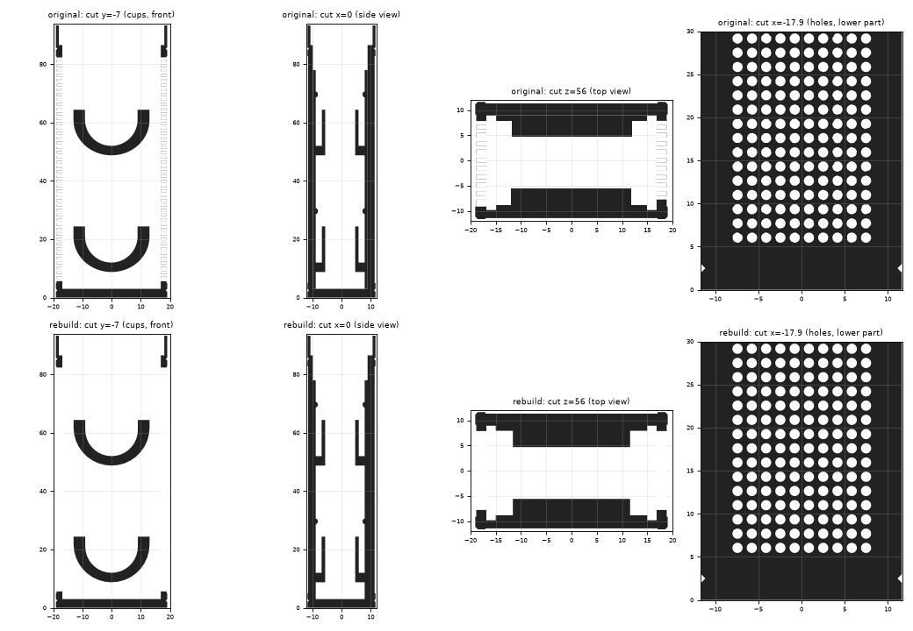

# RTE narrow server and lid (parametric rebuild)

- `narrow_server.py` rebuilds Jan's server
  `originals/3D Model - modifications - Jan/October 2025/RTE/RQB2-R2_NarrowServerSingle-jrl02.stl`
  (SketchUp, mesh only) as a CAD solid.
- `rte_lid.py` rebuilds `originals/RTE/R2_NarrowServerSingleLid.stl`
  (≤ 0.35 mm) and makes its fit adjustable (see "Lid" below).

Both write STL / STEP to `print/RTE/`.

```bash
cd "3D Model/cad/RTE"
python3 narrow_server.py      # ~2 min
python3 rte_lid.py            # --clearance 0.4,0.2 for a tighter fit in y
```

## Lid

A cap the size of the server (38.1 x 23.25 mm, 8.7 mm high, hollow up to a
2 mm top plate) with a 1 mm skirt underneath that slides 6.85 mm into the
server's socket. The skirt is the socket minus `clearance` per side, set
separately for x (long side) and y (short side); the original has 0.4 mm
on both. Jan scales the lid "by a few % in one direction" so it fits on his
printer. Lowering one clearance does the same and leaves the cap
unchanged: 2 % on the short side is about `clearance=(0.4, 0.2)`.

## What it is

An open-top box, 38.1 x 23.25 x 93.3 mm, standing on a 3 mm floor:

- the four vertical edges have a 0.5 mm chamfer, and a 0.5 mm V-groove runs
  round the outside at z = 2.5 and z = 85.3;
- shallow recessed panels on all four faces (z 5 to 82.8; 0.19 mm front,
  0.30 mm back, 0.20 mm sides);
- a lid socket at the top: 1 mm rim from z = 86.55 up;
- **ventilation holes:** a 10 x 47 grid of Ø 1.18 mm holes, pitch 1.65 mm,
  through both narrow side walls;
- inside, on the front and the back wall: a 30 x 75 x 1 mm plate with two
  cups (a U-shaped ring, R 13 outside / R 9 inside, closed by a D-shaped face)
  and two half-round ribs (15 mm long, 0.75 mm high).

Every number is in the `PARAMS` dict at the top of the script, so a change
(e.g. hole size, rows, columns, wall thickness) is a one-line edit.

## How it was made, and how close it is

The original was measured with scripts: cross-sections at many planes,
circle fits for the arcs and holes, hole-grid detection. The model itself is
written by hand from those numbers (unlike the wall, this part is not a stack
of straight profiles, so it cannot be captured automatically).



Comparison against the original (cross-sections at 177 planes, surface
distances from 15,000 sample points):

- surface of the rebuild to the original: median 0.003 mm, 99 % within
  0.13 mm, maximum 0.32 mm (at the cup arcs);
- the CI STL analyzer finds no issues (140k triangles, ~20 segments per hole);
- the rebuild is one closed, valid solid; the original is not watertight
  (the plates and cups are separate bodies overlapping the walls);
- front and back cups are built identical; in the original they differ by
  about 0.1 mm;
- one stray mesh fragment at the edge of the left-side hole field in the
  original is not reproduced.
