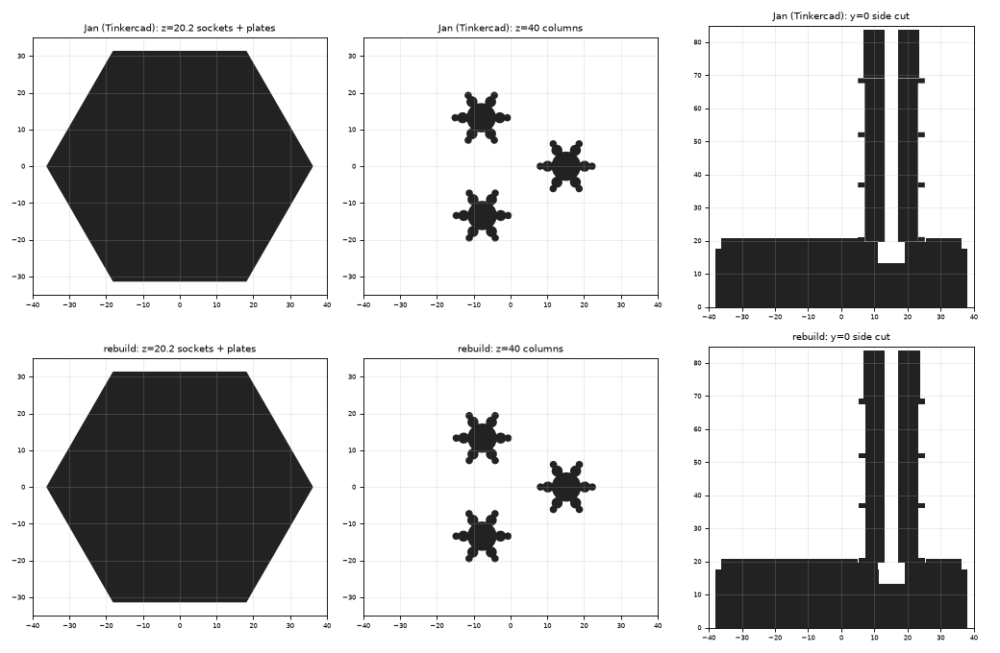
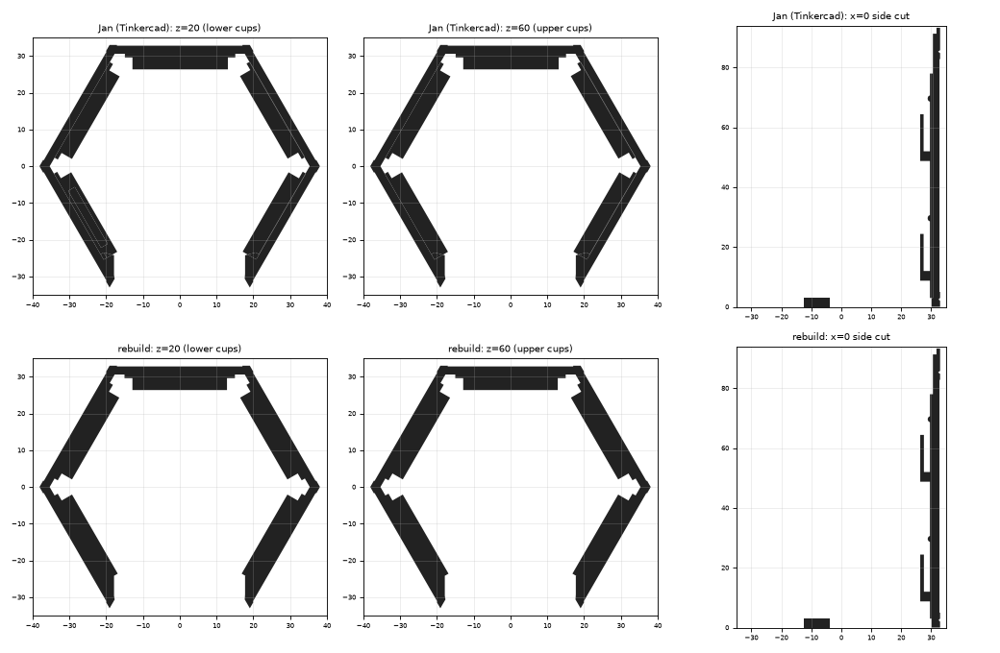

# Cryostat: lid, chandelier, body, door (parametric rebuild)

`cryostat_model.py` and `new_door.py` rebuild the cryostat parts from the
SketchUp and Tinkercad STLs in `originals/`. Each part is written to
`print/cryostat/` under its original file name; Jan's versions sit next to the
part they modify:

| Output | Original | Deviation |
|---|---|---|
| `R2_CryoLid-Simple.*` | `originals/cryostat/R2_CryoLid-Simple.stl` | ≤ 0.03 mm |
| `R2_ChandelierSingle.*` | `originals/cryostat/R2_ChandelierSingle.stl` | ≤ 0.05 mm |
| `RQB2-Cryostat-jrl01.*` | `originals/3D Model - modifications - Jan/October 2025/cryostat/RQB2-Cryostat-jrl01.stl` | ≤ 0.34 mm (see below) |
| `R2_CryoStandaloneGamma.*` | `originals/cryostat/Standalone Version/R2_CryoStandaloneGamma.stl` | shell ≤ 0.05 mm (p99), cups ≤ 1.8 mm (centred, see below) |
| `RQB2-R2_CryoStandaloneGamma-jrl04.*` | `… modifications - Jan/October 2025/cryostat/RQB2-R2_CryoStandaloneGamma-jrl04.stl` | ≤ 0.65 mm (inserts centred) |
| `RQB2-R2_CryoStandaloneGamma-jrl04-no-floor.*` | `… October 2025 - no-floor/cryostat/RQB2-R2_CryoStandaloneGamma-jrl04.stl` | ≤ 0.65 mm |
| `R2_NewDoor.*` (`new_door.py`) | `originals/cryostat/R2_NewDoor.stl` | ≤ 0.05 mm |

```bash
cd "3D Model/cad/cryostat"
python3 extract_cryo_profiles.py <dir with the original STLs>  # only to re-measure
python3 cryostat_model.py                                      # -> print/cryostat/
python3 new_door.py
```

- **Lid:** hexagonal, 76.2 x 66.0 x 20.7 mm, with three sockets on the
  underside (1 mm hexagonal recess + Ø 8 mm hole, 7.35 mm deep). Captured as
  stacked cross-sections, like the wall.
- **Chandelier:** stem (z 0–14.7), six-armed column, four hexagonal plates
  (17.47 mm across flats, 1.5 mm thick), Ø 3.98 mm hole through the middle.
  The stem and column outlines are measured; plates and hole are numbers in
  `CHANDELIER`.
- **jrl01 (Jan's Tinkercad assembly):** the lid turned over (sockets up) with
  three chandeliers hanging upside down from it; each top plate stands in a
  socket recess with 0.1 mm overlap so the parts fuse. One print, lid down.
  Its 3MF has two colours: the lid transparent, the chandeliers silk gold.
- **Door (`new_door.py`):** front panel (38.1 x 93.3 mm, 2.4 mm thick,
  60 deg side bevels, recessed field between two grooves), two rails at the
  back with rounded tops and blind pin holes (the hinge, at z 9.8 and 74.8),
  and a 3 mm foot that reaches under the cryostat. All numbers in `PARAMS`.
  Jan placed the chandeliers by hand, up to 0.27 mm off the socket centres;
  the rebuild puts them exactly on the centres (hence the 0.34 mm).



### Gamma (standalone cryostat body) and Jan's jrl04

- **Shell:** hexagonal, 76.2 x 66.0 x 93.3 mm, five walls, open front with a
  door frame, 3 mm floor with a front notch and a hexagonal opening with three
  tabs, V-grooves round the whole outside at z 2.5 and 85.3, lid socket at the
  top. Captured as stacked cross-sections; the grooves in 0.1 mm layers. The
  SketchUp mesh is broken between z 2.0 and 2.5, so those layers are taken
  from the (repaired) Gamma body in Jan's Tinkercad export.
- **Hinge holes:** Ø 3.18 mm (1/8"), 2.1 mm deep, in each door-frame post at
  z 9.8 and 74.8.
- **Cups** (original only): two per wall, U ring R 10 / R 8 with a D face, the
  bore continuing 0.5 mm into the wall. In the SketchUp file the front-wall
  cups sat up to 0.8 mm off centre and 0.2 mm low; here all are centred.
- **jrl04 (Jan):** the cups replaced by the RTE mounting plate
  (`RTE/narrow_server.py`, `mount_insert`) on all five walls; on the two
  front walls it is cut 3 mm shorter on the door side. Centred on the walls
  (Jan's placement was up to 0.11 mm off). The no-floor version closes the
  floor opening with a Ø 42 x 3 mm disc.


