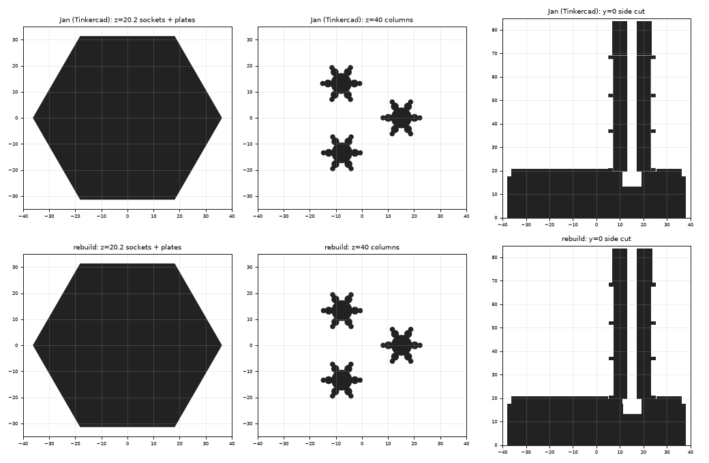

# Cryostat: lid, chandelier, lid with chandeliers (parametric rebuild)

`cryostat_model.py` rebuilds from the SketchUp/Tinkercad STLs:

| Output | Original | Deviation |
|---|---|---|
| `R2_CryoLid-Simple.parametric.*` | `3D Model/cryostat/R2_CryoLid-Simple.stl` | ≤ 0.03 mm |
| `R2_ChandelierSingle.parametric.*` | `3D Model/cryostat/R2_ChandelierSingle.stl` | ≤ 0.05 mm |
| `RQB2-Cryostat-jrl01.parametric.*` | `3D Model - modifications - Jan/October 2025/cryostat/RQB2-Cryostat-jrl01.stl` | ≤ 0.34 mm (see below) |

```bash
cd "3D Model/parametric/cryostat"
../.venv-cad/bin/python extract_cryo_profiles.py <dir with the two original STLs>  # only to re-measure
../.venv-cad/bin/python cryostat_model.py                                          # -> output/
```

- **Lid:** hexagonal, 76.2 x 66.0 x 20.7 mm, with three sockets on the
  underside (1 mm hexagonal recess + Ø 8 mm hole, 7.35 mm deep). Captured as
  stacked cross-sections, like the wall.
- **Chandelier:** stem (z 0–14.7), six-armed column, four hexagonal plates
  (17.47 mm across flats, 1.5 mm thick), Ø 3.98 mm hole through the middle.
  The stem and column outlines are measured; plates and hole are numbers in
  `CHANDELIER`.
- **jrl01 (Jan's Tinkercad assembly):** the lid turned over (sockets up) with
  three chandeliers hanging upside down from it; each top plate stands in a
  socket recess with 0.1 mm overlap so the parts fuse. One print, lid down.
  Jan placed the chandeliers by hand, up to 0.27 mm off the socket centres;
  the rebuild puts them exactly on the centres (hence the 0.34 mm).


