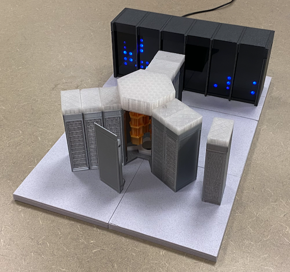
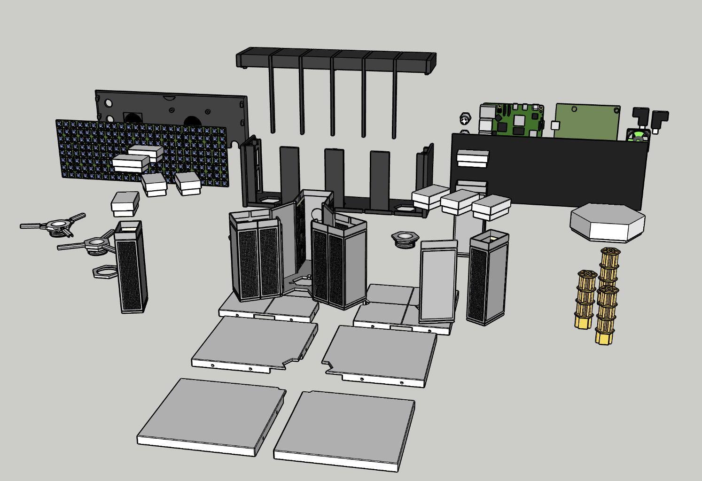

# RasQberry-Two-3Dmodel
3D model of IBM Quantum System Two, to build a functional model of IBM Quantum System Two aka "the RasQberry project".

The model captures the spirit of the System Two design, adhering closely to size ratios of the real physical system, with a little artistic license to produce a model that is
easy to print, assemble and "operate".

The essence of the marketing models used in promotional videos has been captured by fitting the the "Room Temperature Electronics" (RTE) boxes with magnets to give that 
satisfying "clunk" connection to the main cryostat structure.

Credit for the bulk of the 3D design work goes to [Eric Jenney](https://github.com/ejog), with significant input from [Andy Stanford-Clark](https://github.com/andysc),  [Sascha Schefenacker](https://github.com/saschaschefenacker), and [Jan Lahmann](https://github.com/JanLahmann) with ideas and testing input from a whole army of other enthusiastic contributors at IBM.

There are quite a lot of pieces, but they're easy to print, without the need for supports, and the process is [well-documented](https://rasqberry.org/01-3d-model/02-hardware-assembly-guide/).

## Files

All in [`3D Model/print/`](3D%20Model/print):

- **[`originals/`](3D%20Model/print/originals)**: the standard parts, the STL
  files the [assembly guide](https://rasqberry.org/01-3d-model/02-hardware-assembly-guide/)
  shows; which ones, how many and in which color:
  [what to print](https://rasqberry.org/01-3d-model/02-hardware-assembly-guide/#3-what-to-print).
  The folder `3D Model - modifications - Jan` holds variants the guide does not
  cover.
- **[`generated/`](3D%20Model/print/generated)**: parts rebuilt from code
  ([`cad/`](3D%20Model/cad)), the others copied from the originals; STL and
  3MF with the filament color (STEP for nearly all), large parts also split in two
  (`.split-A` / `.split-B`). The [print plates](3D%20Model/print/generated/plates)
  (PrusaSlicer, Prusa Core One) use Jan's variants, a different set from the
  assembly guide. **Not yet tested:** nobody has printed the whole set. Feedback
  is very welcome: [open an issue](https://github.com/JanLahmann/RasQberry-Two/issues)
  or [become a tester](https://rasqberry.org/testing/). For a rebuilt RTE lid that
  is too loose or too tight, adjust its fit in
  [`cad/RTE/rte_lid.py`](3D%20Model/cad/RTE/rte_lid.py).

We hope you have as much fun building a model of the IBM Quantum System Two as we have had designing it!   

